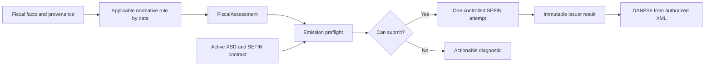

<!--
SPDX-FileCopyrightText: 2026 LibreCode coop and contributors
SPDX-License-Identifier: AGPL-3.0-or-later
-->

# ADR 0002: Immutable fiscal facts and source-backed decisions

Status: Proposed for review

## Boundary

The Akaunting adapter supplies immutable, company-scoped facts for one fiscal
group through `Contracts\FiscalContext`. Tax observations use
`Contracts\FiscalTaxFact` (optional document-item ID, tax ID, association-row ID,
accounting type, amount in integer cents, and explicitly classified fiscal
identity/role when verified), the observed tax-specific base and exact decimal
rate when available, and explicit provenance. A tax-row amount may be null
when not actually observed; integer zero is a distinct observed fact.
Roles are backed by
`FiscalTaxRole` (provider due, withheld by the actual payer, transparency estimate).
An invoice-level tax need not invent a document-item ID of 0.
An absent ID, value origin or classification is `null`, never
guessed from tax names, percentages, a value or an XML element's historic name.

The fiscal application layer returns `Contracts\FiscalAssessment`, a list
of `Contracts\FiscalDecision` records. It must not mutate an Akaunting
invoice, authorized XML, accounting taxes or historic documents. The DTOs
encode no legislation, formula, municipal rate or emission strategy.

## Time and evidence

The context carries **both** the taxable-event date and service-competence
date. Neither date, tax regime, transaction category, taker type nor gross
amount is fabricated when unavailable: `null` means the fact cannot yet
be verified. The tax-fact list likewise distinguishes `null` (not
loaded/unknown) from an observed empty list, and a monetary zero from an
unavailable monetary amount.

A decision names its stable rule ID, category, outcome and severity.
For conclusive `pass`, `fail` and `not_applicable` results, it requires
the primary source URL, provision, version, publication date and effective
start. For `unverifiable` or `unsupported`, source and temporal evidence
may be null when genuinely unavailable; missing municipal consultation data
must not be replaced with fictitious legal provenance. Known evidence may
still be recorded, along with the affected field, correction code and
observed/expected integer-cent values. A source-free `unverifiable`
diagnostic is not legal authorization. Jurisdiction and taxpayer facts
must be supplied explicitly;
an unknown fact is not a default tax rate or exemption. The provider's
cooperative legal form is independent of its tax regime. Gross invoiced
amount is distinct from optional actually paid amount and payment date:
missing payment evidence must not be silently treated as payment.

The optional `CooperativeIbsCbsFacts` preserves separate observations for
the **specific** IBS/CBS cooperative election under LC 214/2025 art. 271:
formal election, submission of the required associates list, independently
confirmed option, effect-from date, direction of supply, association at the
event, and recipient's regular-regime status where relevant. Both the
cooperative-as-provider and cooperative-as-taker situations may occur.
Member-to-cooperative supplies additionally need independently verified
`takerIsCooperative`: a described supply direction alone does not verify the
recipient's legal form. The counterparty's verified `false` is inapplicable;
`null` is unverifiable, not an eligible transaction.
For 2027, the ordinary annual option is effective on 1 January. Decree
12.955/2026 art. 393 § 3 permits an off-cycle effective date for an
option made at the start of operations; that exception requires both verified
`optionAtStartOfOperations` and `cooperativeRegistrationDate`, matching the
confirmed effective date by fiscal civil date. Otherwise eligibility is
`unverifiable` and no zero-rate conclusion is permitted. These immutable
facts are not themselves an authenticated RFB receipt: the future fiscal
adapter owns evidence validation and access control.
A submitted form **without the associates list** is not proof of an effective
election. The independently confirmed election requires evidence of both
steps; missing evidence is not a false or zero value. A verified election
alone does not establish that an individual service qualifies for reduced
rates. The scope and personal-use exceptions in Decree 12.955/2026 art. 392
and CGIBS Resolution 6/2026 art. 392 are separate nullable facts: an
unverified purpose or consumption status is not assumed to qualify.
Other art. 271 exceptions (including participating cooperatives and
specific material goods) need their own legally verified operation facts.
For an associate supplying to the cooperative while not subject to the
regular regime, LC 214/2025 art. 271(I) and the broader exclusion in the
regulatory art. 392(II) require a separate legal reconciliation before a
consumer may assert zero rates; this DTO deliberately does not decide it.
The separate municipal ISS `regEspTrib` code does not establish the IBS/CBS
cooperative election. Never put real member identifiers or option receipts
into synthetic fixtures, logs, or versioned research.

The context separately retains the observed DPS `opSimpNac`,
`regApTribSN` and `regEspTrib` codes, the applicable IBS/CBS collection
regime (Simples or regular), the governmental sphere of the taker
(federal, state, district or municipal, when verified), and the verified
CNPJ legal-nature code. The context also records whether the
actual payer is proven to be the invoiced taker and whether the operation
is a sale to a final consumer. Unknown payer identity and unknown
consumer destination remain null, not a guess from the invoice name or
CPF/CNPJ. A public/private boolean cannot establish whether
the payer is subject to a particular IRRF/PIS/COFINS/CSLL withholding rule:
direct administration, autarchies, foundations and public enterprises have
different legal conditions, and state/municipal contributions may depend on
specific legal arrangements. Consumer-facing estimated-tax transparency
under Law 12.741/2012 and Decree 8.264/2014 also requires knowing
whether the operation is a consumer sale; the MEI dispensation and
Simples disclosure options are independently assessed. These are
**facts** only, not proof of an
allowed tax treatment. A null special-regime code means "unknown"; code 0 means
explicit "none". Applicability, valid enumerations for a particular
published schema, municipality-specific restrictions, and elections by
effective period belong to versioned policies and protocol validation.
Applicability dates are inclusive at both ends; a policy must select the
appropriate calendar date from the operation facts instead of treating
publication or transmission time as its taxable-event date.

A rule's legal applicability is evaluated on the legally relevant
transaction date: event date when the act applies to the taxable event,
competence when a service or municipal condition is competence-scoped,
and actual payment date for obligations expressly triggered by payment.
Different dates must not be silently replaced with invoice issuance date,
system time or transmission time. If the controlling date or its evidence is
unknown, the decision is `unverifiable`, not an inferred exemption.
Protocol compatibility is evaluated **separately** against the
environment-specific active schema and deployment. A newly published NT/XSD
does not automatically become the active production emitter. A successful
gateway response does not retroactively make an incomplete obligation legal.

## Municipal special-regime evidence contract

`regEspTrib` is an ISS/DPS field, not the elective cooperative IBS/CBS
regime. Its national enumeration and cross-field constraints are assessed
separately from municipal authorization. The applicable Anexo I must be
identified by source URL, published file revision and target SEFIN
environment; historical meanings of an E-code are not reused solely because
the error code stayed the same.

E0176, E0177 and E0178 may depend on municipal parametrization, provider
qualification, specific service and the service competence. The versioned
source of each rule is selected first; the rule is then assessed against
the corresponding trusted facts. A city selected in a company profile,
a code accepted by the XSD, or the existence of an ADN record is not proof
that the **provider is eligible** for that regime for that service and date.

To evaluate a specific municipal special-regime case, the application must
bind the following, without inventing missing facts:

- Company ownership and independently verified provider fiscal identity
  (CNPJ/CPF and, where the applicable rule requires it, municipal enrollment
  or autonomous-professional qualification).
- Production versus restricted-production environment; municipality of
  incidence and municipality of issuance **as separate facts**.
- DPS `regEspTrib`, `opSimpNac`, `regApTribSN`, `tribISSQN`, national
  six-digit service code, municipal three-digit complement and actual
  nine-digit service code.
- The competent fiscal date, official source version and applicability
  interval, including municipality-specific effective periods and any
  required provider/service permission.
- Evidence origin, retrieval time, freshness, scope and verification
  mechanism. A mutable item catalogue or user-entered assertion is not an
  authenticated issuer authorization.

The already implemented `MunicipalEmissionPreflight` and
`MunicipalAdmissibilityEvaluator` preserve company, environment, incidence
municipality, service and DPS competence when matching advisory cached
parameters. `OfficialMunicipalIssuanceEvidence` binds a verified issuer
response to the *same final DPS* using DPS identity and digest. Extending
the assessment of E0176–E0178 belongs to the municipal-regime policy, not
to a parallel fiscal engine in this ADR.

The outcomes remain distinct:

| Input / evidence | Fiscal interpretation |
| --- | --- |
| Objectively invalid national regime/ISS combination | `fail` / block, with the applicable normative rule |
| Complete, authenticated municipality-specific permission matching the operation | Eligible *only for the proven condition*; not universal permission |
| Municipal parameter 404, timeout, stale cache, omitted parameter or partial provider/service evidence | `unverifiable`, with provenance and actionable missing facts; no fabricated pass or fail |
| Authenticated SEFIN rejection bound to this exact DPS | A technical rejection of that attempt; never a global, retroactive prohibition |
| Valid XSD or successful emission with no separate statutory assessment | Protocol success only; no implicit tax-law certification |

A query to ADN can be advisory even when the issuer accepts or rejects
this DPS later. `unverifiable` does not automatically mean a fictional
SEFIN rejection: whether the current operation may **attempt** submission
is decided only at the appropriate existing emission boundary and from
the actual mandatory legal inputs. Conversely, legal obligations cannot
be disabled because the gateway temporarily does not reject missing fields.

## Selection and change-control boundary

The fiscal rule, its reference date and its statutory status are separate
from the active transport contract, XSD deployment, issuer response and
DANFSe rendering date. The application may use the same published rule in
more than one environment, but it must not assume two identically numbered
XSD bundles have identical content. An official notice of an upcoming NT
does not automatically authorize a different production emitter.

The stable interfaces and rule IDs can be revised by signed, reviewed
code changes. New versions must use independent synthetic counterexamples
and verify the interaction with obligations for the actual legal period.
No rule table in this ADR is a substitute for current municipal law,
the official annex binary or an independent fiscal/legal approval of
contested tax treatments.

## Outcomes and ownership

The permitted decision categories are `normative`, `calculation`,
`document` and `protocol`; statuses are `pass`, `fail`,
`not_applicable`, `unverifiable` and `unsupported`; severity is
`block`, `warn` or `info`. An empty assessment means no explicit
assessment outcome was provided; it is **not** implicit permission to emit.
An explicit `not_applicable` outcome is distinct from a rule that was never
evaluated. A consumer must not equate `unverifiable` with `pass`, nor
assume every unavailable advisory municipal query is a fiscal rejection. Where a demonstrably mandatory
requirement cannot be satisfied, the emission preflight blocks at the common
last boundary before the fiscal POST.

The module owns context adaptation, statutory obligation and monetary-rule
assessment. `nfse-php` owns active versioned XML serialization, signature,
transport, XML schema validation and faithful DANFSe rendering from authorized
data. Previously authorized artifacts stay immutable. Actual rule strategies,
test scenarios and rollout decisions live in their respective implementation
work; this ADR deliberately defines no generic rule engine, DSL or arbitrary
database-configured tax formulas.
